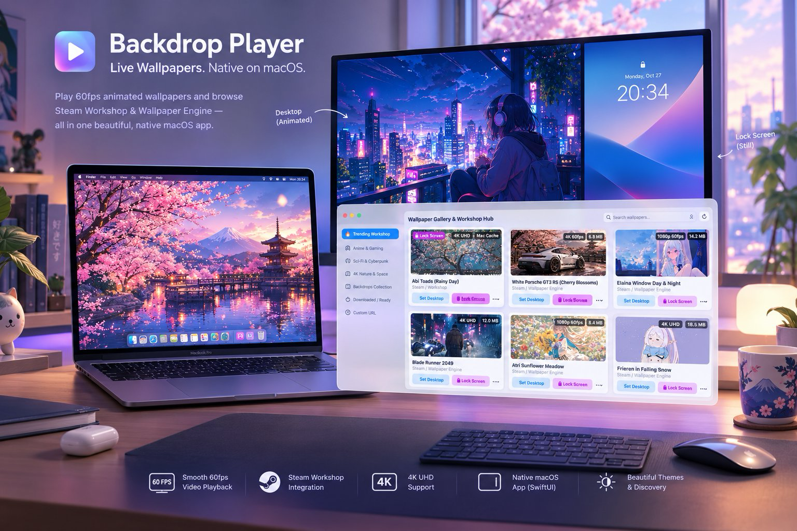

<p align="center">
  
</p>

# Backdrop Player (macOS)

A high-performance, ultra-lightweight native macOS wallpaper engine and dynamic **Steam Workshop & Wallpaper Engine** client built with **Swift 6**, **AppKit**, **SwiftUI**, and **AVFoundation**.

Render 60fps hardware-accelerated animated video wallpapers smoothly on your macOS desktop while keeping your Lock Screen completely independent.

---

## ✨ Features

- **⚡ Hardware-Accelerated & Ultra Low Overhead**:
  - Uses Apple's VideoToolbox via `AVQueuePlayer` and `AVPlayerLooper` for seamless 60/120fps video playback with `< 1% CPU` and minimal battery consumption.
- **🔒 Decoupled Desktop & Lock Screen Engine**:
  - Independently configure your macOS Lock Screen (e.g. *Abi Toads*) while simultaneously playing high-framerate dynamic video wallpapers on your desktop.
  - Zero-CPU idle suspension: Automatically pauses video playback when your Mac locks (`com.apple.screenIsLocked`) and instantly resumes upon unlocking (`com.apple.screenIsUnlocked`).
- **🌐 Live Steam Workshop & Wallpaper Engine Client**:
  - Direct in-app Steam Workshop browser: Queries Steam Community live API data (`appid=431960`) with real-time SSR JSON parsing.
  - Search any keyword (e.g., *toad*, *cyberpunk*, *porsche*, *anime*, *genshin*, *nature*) to stream real-time catalog results, CDN preview thumbnails, and subscriber counts without manual link copying.
- **🖥️ True Desktop Window Layering**:
  - Positions the wallpaper window directly at `kCGDesktopWindowLevel + 2` behind desktop icons, allowing full interaction with desktop files, selection rectangles, and Finder context menus.
- **🌌 Mission Control & Spaces Persistence**:
  - Stays sticky across all macOS virtual desktops and Spaces without flickering during transitions.
- **🔄 Auto-Discovery & Local Sourcing**:
  - Discovers clean local wallpapers and detects cached assets from the Backdrop app database (`Backdrop.sqlite`).
- **🔋 Battery-Conscious Sleep Detection**:
  - Automatically pauses playback when displays sleep and resumes immediately upon wake.
- **🖥️ Multi-Display Support**:
  - Independent playback sessions for every connected display with automatic resolution adapting.
- **🎛️ Menu Bar & 1-Click Controls**:
  - **Browse Wallpaper Gallery & Workshop...** (`⌘G`)
  - 1-Click **Set Desktop**, **Set Lock**, or **Set Both** directly from cards.
  - Play / Pause (`⌘P`), Mute / Unmute (`⌘M`), Scaling modes (Fill vs Fit).

---

## 🎨 In-App Wallpaper Gallery & Sourcing (`⌘G`)

`BackdropPlayer` now includes a complete native **SwiftUI Wallpaper Store & Gallery**:
- **4K Apple Aerials (Official High-Speed CDN)**: Official Apple 4K HDR live streams (Earth & ISS, Auroras, Palau Jellies, Iceland, London, Tokyo, Los Angeles).
- **Backdrop Local Cache (Instant 1-Click Import)**: Instantly detects and imports all 44 high-res video wallpapers cached from Backdrop (*Goku Starlight*, *Bambi Cottage*, *Dark Souls 3*, *Minecraft Northern Lights*, *Snoopy Cafe*, etc.).
- **Direct Video URL Downloader**: Paste any `.mp4` or `.mov` link from the web to download and immediately set as desktop wallpaper with real-time download progress.

---

## 🛠️ Build & Run

### Quick Run (Swift Package Manager)

```bash
cd ~/Documents/GitHub/backdrop-player
swift run
```

### Build Standalone `.app` Bundle

```bash
cd ~/Documents/GitHub/backdrop-player
./scripts/build-app.sh
```

The output will be created at:
`dist/BackdropPlayer.app`

To launch it:
```bash
open dist/BackdropPlayer.app
```

To install it into your system Applications folder:
```bash
cp -R dist/BackdropPlayer.app /Applications/
open /Applications/BackdropPlayer.app
```

---

## 📁 Project Architecture

```
backdrop-player/
├── Package.swift                    # Swift package specification (macOS 13+)
├── scripts/
│   └── build-app.sh                 # Releases and packages BackdropPlayer.app bundle
└── Sources/
    ├── main.swift                   # Application entry point
    ├── AppDelegate.swift            # NSApplicationDelegate (menu bar accessory mode)
    ├── Models/
    │   └── WallpaperItem.swift      # Wallpaper model (id, title, type, fileURL, size)
    ├── Services/
    │   └── BackdropLibraryService.swift # SQLite3 query & folder watcher
    ├── Views/
    │   └── WallpaperWindow.swift    # Borderless desktop-layer NSWindow
    └── Controllers/
        ├── WallpaperEngine.swift    # AVQueuePlayer + AVPlayerLooper multi-screen engine
        └── StatusBarController.swift # NSStatusItem & menu management
```
